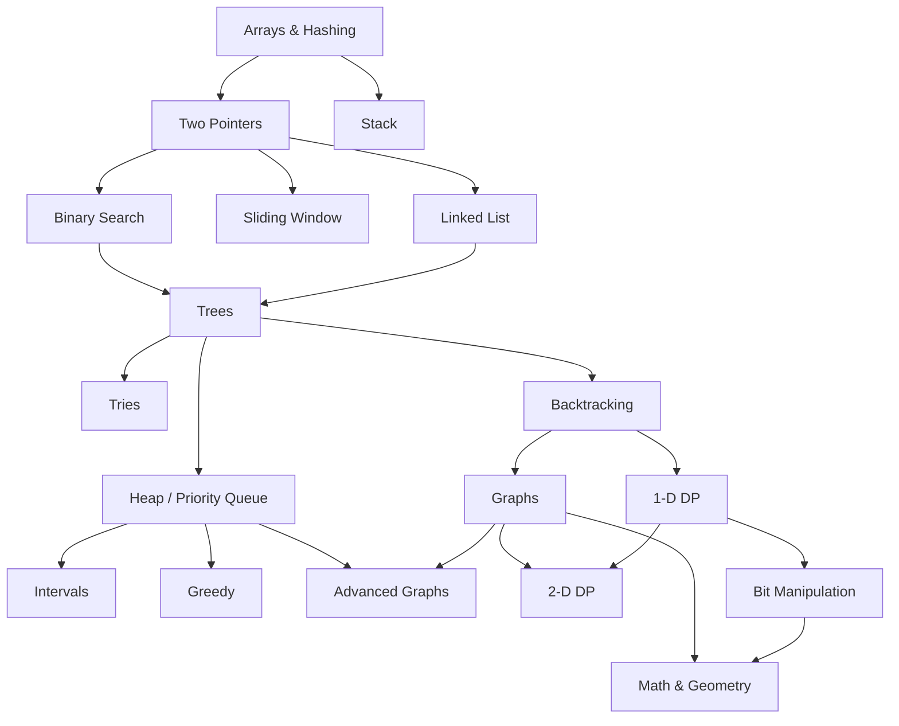

# NeetCode 150

All 150 problems in NeetCode's order: **18 topics**, each split into **subtopics** (the pattern the problems share). Do the topics top to bottom; inside a topic, any order works, but Easy → Medium → Hard is a good default.

✅ = solved and logged in `solutions/`. 🔒 = LeetCode Premium. Solve those free on [neetcode.io](https://neetcode.io/practice) or LintCode instead.

## Roadmap

## Progress

| # | Topic | Problems | 🟢 | 🟡 | 🔴 | Done |
|---|---|---|---|---|---|---|
| 1 | [Arrays & Hashing](#arrays--hashing) | 9 | 3 | 6 | 0 | 0 / 9 |
| 2 | [Two Pointers](#two-pointers) | 5 | 1 | 3 | 1 | 0 / 5 |
| 3 | [Sliding Window](#sliding-window) | 6 | 1 | 3 | 2 | 1 / 6 |
| 4 | [Stack](#stack) | 7 | 1 | 5 | 1 | 0 / 7 |
| 5 | [Binary Search](#binary-search) | 7 | 1 | 5 | 1 | 0 / 7 |
| 6 | [Linked List](#linked-list) | 11 | 3 | 6 | 2 | 0 / 11 |
| 7 | [Trees](#trees) | 15 | 6 | 7 | 2 | 0 / 15 |
| 8 | [Tries](#tries) | 3 | 0 | 2 | 1 | 0 / 3 |
| 9 | [Heap / Priority Queue](#heap--priority-queue) | 7 | 2 | 4 | 1 | 0 / 7 |
| 10 | [Backtracking](#backtracking) | 9 | 0 | 8 | 1 | 0 / 9 |
| 11 | [Graphs](#graphs) | 13 | 0 | 12 | 1 | 0 / 13 |
| 12 | [Advanced Graphs](#advanced-graphs) | 6 | 0 | 3 | 3 | 0 / 6 |
| 13 | [1-D Dynamic Programming](#1-d-dynamic-programming) | 12 | 2 | 10 | 0 | 0 / 12 |
| 14 | [2-D Dynamic Programming](#2-d-dynamic-programming) | 11 | 0 | 7 | 4 | 0 / 11 |
| 15 | [Greedy](#greedy) | 8 | 0 | 8 | 0 | 0 / 8 |
| 16 | [Intervals](#intervals) | 6 | 1 | 4 | 1 | 0 / 6 |
| 17 | [Math & Geometry](#math--geometry) | 8 | 2 | 6 | 0 | 0 / 8 |
| 18 | [Bit Manipulation](#bit-manipulation) | 7 | 5 | 2 | 0 | 0 / 7 |
| | **Total** | **150** | | | | **1 / 150** |

## Arrays & Hashing

Folder: `solutions/arrays-hashing/`

**Hash set / counting**

| # | Problem | Difficulty | Status |
|---|---|---|---|
| 1 | [217. Contains Duplicate](https://leetcode.com/problems/contains-duplicate/) | 🟢 Easy |  |
| 2 | [242. Valid Anagram](https://leetcode.com/problems/valid-anagram/) | 🟢 Easy |  |
| 3 | [1. Two Sum](https://leetcode.com/problems/two-sum/) | 🟢 Easy |  |

**Grouping & frequency**

| # | Problem | Difficulty | Status |
|---|---|---|---|
| 4 | [49. Group Anagrams](https://leetcode.com/problems/group-anagrams/) | 🟡 Medium |  |
| 5 | [347. Top K Frequent Elements](https://leetcode.com/problems/top-k-frequent-elements/) | 🟡 Medium |  |
| 6 | [271. Encode and Decode Strings](https://leetcode.com/problems/encode-and-decode-strings/) 🔒 | 🟡 Medium |  |

**Array tricks**

| # | Problem | Difficulty | Status |
|---|---|---|---|
| 7 | [238. Product of Array Except Self](https://leetcode.com/problems/product-of-array-except-self/) | 🟡 Medium |  |
| 8 | [36. Valid Sudoku](https://leetcode.com/problems/valid-sudoku/) | 🟡 Medium |  |
| 9 | [128. Longest Consecutive Sequence](https://leetcode.com/problems/longest-consecutive-sequence/) | 🟡 Medium |  |

## Two Pointers

Folder: `solutions/two-pointers/`

**Opposite ends**

| # | Problem | Difficulty | Status |
|---|---|---|---|
| 10 | [125. Valid Palindrome](https://leetcode.com/problems/valid-palindrome/) | 🟢 Easy |  |
| 11 | [167. Two Sum II - Input Array Is Sorted](https://leetcode.com/problems/two-sum-ii-input-array-is-sorted/) | 🟡 Medium |  |
| 12 | [15. 3Sum](https://leetcode.com/problems/3sum/) | 🟡 Medium |  |

**Area / water**

| # | Problem | Difficulty | Status |
|---|---|---|---|
| 13 | [11. Container With Most Water](https://leetcode.com/problems/container-with-most-water/) | 🟡 Medium |  |
| 14 | [42. Trapping Rain Water](https://leetcode.com/problems/trapping-rain-water/) | 🔴 Hard |  |

## Sliding Window

Folder: `solutions/sliding-window/`

**Variable window**

| # | Problem | Difficulty | Status |
|---|---|---|---|
| 15 | [121. Best Time to Buy and Sell Stock](https://leetcode.com/problems/best-time-to-buy-and-sell-stock/) | 🟢 Easy | ✅ |
| 16 | [3. Longest Substring Without Repeating Characters](https://leetcode.com/problems/longest-substring-without-repeating-characters/) | 🟡 Medium |  |
| 17 | [424. Longest Repeating Character Replacement](https://leetcode.com/problems/longest-repeating-character-replacement/) | 🟡 Medium |  |

**Window + counts**

| # | Problem | Difficulty | Status |
|---|---|---|---|
| 18 | [567. Permutation in String](https://leetcode.com/problems/permutation-in-string/) | 🟡 Medium |  |
| 19 | [76. Minimum Window Substring](https://leetcode.com/problems/minimum-window-substring/) | 🔴 Hard |  |

**Monotonic deque**

| # | Problem | Difficulty | Status |
|---|---|---|---|
| 20 | [239. Sliding Window Maximum](https://leetcode.com/problems/sliding-window-maximum/) | 🔴 Hard |  |

## Stack

Folder: `solutions/stack/`

**Basic stack**

| # | Problem | Difficulty | Status |
|---|---|---|---|
| 21 | [20. Valid Parentheses](https://leetcode.com/problems/valid-parentheses/) | 🟢 Easy |  |
| 22 | [155. Min Stack](https://leetcode.com/problems/min-stack/) | 🟡 Medium |  |
| 23 | [150. Evaluate Reverse Polish Notation](https://leetcode.com/problems/evaluate-reverse-polish-notation/) | 🟡 Medium |  |

**Backtracking with a stack**

| # | Problem | Difficulty | Status |
|---|---|---|---|
| 24 | [22. Generate Parentheses](https://leetcode.com/problems/generate-parentheses/) | 🟡 Medium |  |

**Monotonic stack**

| # | Problem | Difficulty | Status |
|---|---|---|---|
| 25 | [739. Daily Temperatures](https://leetcode.com/problems/daily-temperatures/) | 🟡 Medium |  |
| 26 | [853. Car Fleet](https://leetcode.com/problems/car-fleet/) | 🟡 Medium |  |
| 27 | [84. Largest Rectangle in Histogram](https://leetcode.com/problems/largest-rectangle-in-histogram/) | 🔴 Hard |  |

## Binary Search

Folder: `solutions/binary-search/`

**Classic**

| # | Problem | Difficulty | Status |
|---|---|---|---|
| 28 | [704. Binary Search](https://leetcode.com/problems/binary-search/) | 🟢 Easy |  |
| 29 | [74. Search a 2D Matrix](https://leetcode.com/problems/search-a-2d-matrix/) | 🟡 Medium |  |

**Search on the answer**

| # | Problem | Difficulty | Status |
|---|---|---|---|
| 30 | [875. Koko Eating Bananas](https://leetcode.com/problems/koko-eating-bananas/) | 🟡 Medium |  |

**Rotated arrays**

| # | Problem | Difficulty | Status |
|---|---|---|---|
| 31 | [153. Find Minimum in Rotated Sorted Array](https://leetcode.com/problems/find-minimum-in-rotated-sorted-array/) | 🟡 Medium |  |
| 32 | [33. Search in Rotated Sorted Array](https://leetcode.com/problems/search-in-rotated-sorted-array/) | 🟡 Medium |  |

**Design / hard**

| # | Problem | Difficulty | Status |
|---|---|---|---|
| 33 | [981. Time Based Key-Value Store](https://leetcode.com/problems/time-based-key-value-store/) | 🟡 Medium |  |
| 34 | [4. Median of Two Sorted Arrays](https://leetcode.com/problems/median-of-two-sorted-arrays/) | 🔴 Hard |  |

## Linked List

Folder: `solutions/linked-list/`

**Pointer basics**

| # | Problem | Difficulty | Status |
|---|---|---|---|
| 35 | [206. Reverse Linked List](https://leetcode.com/problems/reverse-linked-list/) | 🟢 Easy |  |
| 36 | [21. Merge Two Sorted Lists](https://leetcode.com/problems/merge-two-sorted-lists/) | 🟢 Easy |  |
| 37 | [143. Reorder List](https://leetcode.com/problems/reorder-list/) | 🟡 Medium |  |
| 38 | [19. Remove Nth Node From End of List](https://leetcode.com/problems/remove-nth-node-from-end-of-list/) | 🟡 Medium |  |

**Hashing + lists**

| # | Problem | Difficulty | Status |
|---|---|---|---|
| 39 | [138. Copy List with Random Pointer](https://leetcode.com/problems/copy-list-with-random-pointer/) | 🟡 Medium |  |
| 40 | [2. Add Two Numbers](https://leetcode.com/problems/add-two-numbers/) | 🟡 Medium |  |

**Fast & slow pointers**

| # | Problem | Difficulty | Status |
|---|---|---|---|
| 41 | [141. Linked List Cycle](https://leetcode.com/problems/linked-list-cycle/) | 🟢 Easy |  |
| 42 | [287. Find the Duplicate Number](https://leetcode.com/problems/find-the-duplicate-number/) | 🟡 Medium |  |

**Design / hard**

| # | Problem | Difficulty | Status |
|---|---|---|---|
| 43 | [146. LRU Cache](https://leetcode.com/problems/lru-cache/) | 🟡 Medium |  |
| 44 | [23. Merge k Sorted Lists](https://leetcode.com/problems/merge-k-sorted-lists/) | 🔴 Hard |  |
| 45 | [25. Reverse Nodes in k-Group](https://leetcode.com/problems/reverse-nodes-in-k-group/) | 🔴 Hard |  |

## Trees

Folder: `solutions/trees/`

**DFS basics**

| # | Problem | Difficulty | Status |
|---|---|---|---|
| 46 | [226. Invert Binary Tree](https://leetcode.com/problems/invert-binary-tree/) | 🟢 Easy |  |
| 47 | [104. Maximum Depth of Binary Tree](https://leetcode.com/problems/maximum-depth-of-binary-tree/) | 🟢 Easy |  |
| 48 | [543. Diameter of Binary Tree](https://leetcode.com/problems/diameter-of-binary-tree/) | 🟢 Easy |  |
| 49 | [110. Balanced Binary Tree](https://leetcode.com/problems/balanced-binary-tree/) | 🟢 Easy |  |
| 50 | [100. Same Tree](https://leetcode.com/problems/same-tree/) | 🟢 Easy |  |
| 51 | [572. Subtree of Another Tree](https://leetcode.com/problems/subtree-of-another-tree/) | 🟢 Easy |  |

**BFS / level order**

| # | Problem | Difficulty | Status |
|---|---|---|---|
| 52 | [102. Binary Tree Level Order Traversal](https://leetcode.com/problems/binary-tree-level-order-traversal/) | 🟡 Medium |  |
| 53 | [199. Binary Tree Right Side View](https://leetcode.com/problems/binary-tree-right-side-view/) | 🟡 Medium |  |
| 54 | [1448. Count Good Nodes in Binary Tree](https://leetcode.com/problems/count-good-nodes-in-binary-tree/) | 🟡 Medium |  |

**Binary search trees**

| # | Problem | Difficulty | Status |
|---|---|---|---|
| 55 | [235. Lowest Common Ancestor of a Binary Search Tree](https://leetcode.com/problems/lowest-common-ancestor-of-a-binary-search-tree/) | 🟡 Medium |  |
| 56 | [98. Validate Binary Search Tree](https://leetcode.com/problems/validate-binary-search-tree/) | 🟡 Medium |  |
| 57 | [230. Kth Smallest Element in a BST](https://leetcode.com/problems/kth-smallest-element-in-a-bst/) | 🟡 Medium |  |

**Construction / hard**

| # | Problem | Difficulty | Status |
|---|---|---|---|
| 58 | [105. Construct Binary Tree from Preorder and Inorder Traversal](https://leetcode.com/problems/construct-binary-tree-from-preorder-and-inorder-traversal/) | 🟡 Medium |  |
| 59 | [124. Binary Tree Maximum Path Sum](https://leetcode.com/problems/binary-tree-maximum-path-sum/) | 🔴 Hard |  |
| 60 | [297. Serialize and Deserialize Binary Tree](https://leetcode.com/problems/serialize-and-deserialize-binary-tree/) | 🔴 Hard |  |

## Tries

Folder: `solutions/tries/`

**Trie**

| # | Problem | Difficulty | Status |
|---|---|---|---|
| 61 | [208. Implement Trie (Prefix Tree)](https://leetcode.com/problems/implement-trie-prefix-tree/) | 🟡 Medium |  |
| 62 | [211. Design Add and Search Words Data Structure](https://leetcode.com/problems/design-add-and-search-words-data-structure/) | 🟡 Medium |  |
| 63 | [212. Word Search II](https://leetcode.com/problems/word-search-ii/) | 🔴 Hard |  |

## Heap / Priority Queue

Folder: `solutions/heap/`

**Top-k / kth**

| # | Problem | Difficulty | Status |
|---|---|---|---|
| 64 | [703. Kth Largest Element in a Stream](https://leetcode.com/problems/kth-largest-element-in-a-stream/) | 🟢 Easy |  |
| 65 | [1046. Last Stone Weight](https://leetcode.com/problems/last-stone-weight/) | 🟢 Easy |  |
| 66 | [973. K Closest Points to Origin](https://leetcode.com/problems/k-closest-points-to-origin/) | 🟡 Medium |  |
| 67 | [215. Kth Largest Element in an Array](https://leetcode.com/problems/kth-largest-element-in-an-array/) | 🟡 Medium |  |

**Scheduling / design**

| # | Problem | Difficulty | Status |
|---|---|---|---|
| 68 | [621. Task Scheduler](https://leetcode.com/problems/task-scheduler/) | 🟡 Medium |  |
| 69 | [355. Design Twitter](https://leetcode.com/problems/design-twitter/) | 🟡 Medium |  |

**Two heaps**

| # | Problem | Difficulty | Status |
|---|---|---|---|
| 70 | [295. Find Median from Data Stream](https://leetcode.com/problems/find-median-from-data-stream/) | 🔴 Hard |  |

## Backtracking

Folder: `solutions/backtracking/`

**Subsets**

| # | Problem | Difficulty | Status |
|---|---|---|---|
| 71 | [78. Subsets](https://leetcode.com/problems/subsets/) | 🟡 Medium |  |
| 72 | [90. Subsets II](https://leetcode.com/problems/subsets-ii/) | 🟡 Medium |  |

**Combinations**

| # | Problem | Difficulty | Status |
|---|---|---|---|
| 73 | [39. Combination Sum](https://leetcode.com/problems/combination-sum/) | 🟡 Medium |  |
| 74 | [40. Combination Sum II](https://leetcode.com/problems/combination-sum-ii/) | 🟡 Medium |  |
| 75 | [17. Letter Combinations of a Phone Number](https://leetcode.com/problems/letter-combinations-of-a-phone-number/) | 🟡 Medium |  |

**Permutations**

| # | Problem | Difficulty | Status |
|---|---|---|---|
| 76 | [46. Permutations](https://leetcode.com/problems/permutations/) | 🟡 Medium |  |

**Grid / partition**

| # | Problem | Difficulty | Status |
|---|---|---|---|
| 77 | [79. Word Search](https://leetcode.com/problems/word-search/) | 🟡 Medium |  |
| 78 | [131. Palindrome Partitioning](https://leetcode.com/problems/palindrome-partitioning/) | 🟡 Medium |  |
| 79 | [51. N-Queens](https://leetcode.com/problems/n-queens/) | 🔴 Hard |  |

## Graphs

Folder: `solutions/graphs/`

**Grid DFS / BFS**

| # | Problem | Difficulty | Status |
|---|---|---|---|
| 80 | [200. Number of Islands](https://leetcode.com/problems/number-of-islands/) | 🟡 Medium |  |
| 81 | [695. Max Area of Island](https://leetcode.com/problems/max-area-of-island/) | 🟡 Medium |  |
| 82 | [417. Pacific Atlantic Water Flow](https://leetcode.com/problems/pacific-atlantic-water-flow/) | 🟡 Medium |  |
| 83 | [130. Surrounded Regions](https://leetcode.com/problems/surrounded-regions/) | 🟡 Medium |  |

**Multi-source BFS**

| # | Problem | Difficulty | Status |
|---|---|---|---|
| 84 | [994. Rotting Oranges](https://leetcode.com/problems/rotting-oranges/) | 🟡 Medium |  |
| 85 | [286. Walls and Gates](https://leetcode.com/problems/walls-and-gates/) 🔒 | 🟡 Medium |  |

**Graph traversal**

| # | Problem | Difficulty | Status |
|---|---|---|---|
| 86 | [133. Clone Graph](https://leetcode.com/problems/clone-graph/) | 🟡 Medium |  |
| 87 | [127. Word Ladder](https://leetcode.com/problems/word-ladder/) | 🔴 Hard |  |

**Topological sort**

| # | Problem | Difficulty | Status |
|---|---|---|---|
| 88 | [207. Course Schedule](https://leetcode.com/problems/course-schedule/) | 🟡 Medium |  |
| 89 | [210. Course Schedule II](https://leetcode.com/problems/course-schedule-ii/) | 🟡 Medium |  |

**Union-find**

| # | Problem | Difficulty | Status |
|---|---|---|---|
| 90 | [684. Redundant Connection](https://leetcode.com/problems/redundant-connection/) | 🟡 Medium |  |
| 91 | [323. Number of Connected Components in an Undirected Graph](https://leetcode.com/problems/number-of-connected-components-in-an-undirected-graph/) 🔒 | 🟡 Medium |  |
| 92 | [261. Graph Valid Tree](https://leetcode.com/problems/graph-valid-tree/) 🔒 | 🟡 Medium |  |

## Advanced Graphs

Folder: `solutions/advanced-graphs/`

**Shortest path (Dijkstra / Bellman-Ford)**

| # | Problem | Difficulty | Status |
|---|---|---|---|
| 93 | [743. Network Delay Time](https://leetcode.com/problems/network-delay-time/) | 🟡 Medium |  |
| 94 | [778. Swim in Rising Water](https://leetcode.com/problems/swim-in-rising-water/) | 🔴 Hard |  |
| 95 | [787. Cheapest Flights Within K Stops](https://leetcode.com/problems/cheapest-flights-within-k-stops/) | 🟡 Medium |  |

**Minimum spanning tree**

| # | Problem | Difficulty | Status |
|---|---|---|---|
| 96 | [1584. Min Cost to Connect All Points](https://leetcode.com/problems/min-cost-to-connect-all-points/) | 🟡 Medium |  |

**Eulerian path / topo sort**

| # | Problem | Difficulty | Status |
|---|---|---|---|
| 97 | [332. Reconstruct Itinerary](https://leetcode.com/problems/reconstruct-itinerary/) | 🔴 Hard |  |
| 98 | [269. Alien Dictionary](https://leetcode.com/problems/alien-dictionary/) 🔒 | 🔴 Hard |  |

## 1-D Dynamic Programming

Folder: `solutions/1d-dp/`

**Fibonacci-style**

| # | Problem | Difficulty | Status |
|---|---|---|---|
| 99 | [70. Climbing Stairs](https://leetcode.com/problems/climbing-stairs/) | 🟢 Easy |  |
| 100 | [746. Min Cost Climbing Stairs](https://leetcode.com/problems/min-cost-climbing-stairs/) | 🟢 Easy |  |
| 101 | [198. House Robber](https://leetcode.com/problems/house-robber/) | 🟡 Medium |  |
| 102 | [213. House Robber II](https://leetcode.com/problems/house-robber-ii/) | 🟡 Medium |  |

**Palindromes**

| # | Problem | Difficulty | Status |
|---|---|---|---|
| 103 | [5. Longest Palindromic Substring](https://leetcode.com/problems/longest-palindromic-substring/) | 🟡 Medium |  |
| 104 | [647. Palindromic Substrings](https://leetcode.com/problems/palindromic-substrings/) | 🟡 Medium |  |

**Counting / choices**

| # | Problem | Difficulty | Status |
|---|---|---|---|
| 105 | [91. Decode Ways](https://leetcode.com/problems/decode-ways/) | 🟡 Medium |  |
| 106 | [322. Coin Change](https://leetcode.com/problems/coin-change/) | 🟡 Medium |  |
| 107 | [152. Maximum Product Subarray](https://leetcode.com/problems/maximum-product-subarray/) | 🟡 Medium |  |
| 108 | [139. Word Break](https://leetcode.com/problems/word-break/) | 🟡 Medium |  |

**Subsequences / knapsack**

| # | Problem | Difficulty | Status |
|---|---|---|---|
| 109 | [300. Longest Increasing Subsequence](https://leetcode.com/problems/longest-increasing-subsequence/) | 🟡 Medium |  |
| 110 | [416. Partition Equal Subset Sum](https://leetcode.com/problems/partition-equal-subset-sum/) | 🟡 Medium |  |

## 2-D Dynamic Programming

Folder: `solutions/2d-dp/`

**Grid paths**

| # | Problem | Difficulty | Status |
|---|---|---|---|
| 111 | [62. Unique Paths](https://leetcode.com/problems/unique-paths/) | 🟡 Medium |  |
| 112 | [329. Longest Increasing Path in a Matrix](https://leetcode.com/problems/longest-increasing-path-in-a-matrix/) | 🔴 Hard |  |

**Two strings**

| # | Problem | Difficulty | Status |
|---|---|---|---|
| 113 | [1143. Longest Common Subsequence](https://leetcode.com/problems/longest-common-subsequence/) | 🟡 Medium |  |
| 114 | [97. Interleaving String](https://leetcode.com/problems/interleaving-string/) | 🟡 Medium |  |
| 115 | [115. Distinct Subsequences](https://leetcode.com/problems/distinct-subsequences/) | 🔴 Hard |  |
| 116 | [72. Edit Distance](https://leetcode.com/problems/edit-distance/) | 🟡 Medium |  |
| 117 | [10. Regular Expression Matching](https://leetcode.com/problems/regular-expression-matching/) | 🔴 Hard |  |

**Knapsack / states**

| # | Problem | Difficulty | Status |
|---|---|---|---|
| 118 | [309. Best Time to Buy and Sell Stock with Cooldown](https://leetcode.com/problems/best-time-to-buy-and-sell-stock-with-cooldown/) | 🟡 Medium |  |
| 119 | [518. Coin Change II](https://leetcode.com/problems/coin-change-ii/) | 🟡 Medium |  |
| 120 | [494. Target Sum](https://leetcode.com/problems/target-sum/) | 🟡 Medium |  |

**Interval DP**

| # | Problem | Difficulty | Status |
|---|---|---|---|
| 121 | [312. Burst Balloons](https://leetcode.com/problems/burst-balloons/) | 🔴 Hard |  |

## Greedy

Folder: `solutions/greedy/`

**Kadane / reach**

| # | Problem | Difficulty | Status |
|---|---|---|---|
| 122 | [53. Maximum Subarray](https://leetcode.com/problems/maximum-subarray/) | 🟡 Medium |  |
| 123 | [55. Jump Game](https://leetcode.com/problems/jump-game/) | 🟡 Medium |  |
| 124 | [45. Jump Game II](https://leetcode.com/problems/jump-game-ii/) | 🟡 Medium |  |
| 125 | [134. Gas Station](https://leetcode.com/problems/gas-station/) | 🟡 Medium |  |

**Grouping / counting**

| # | Problem | Difficulty | Status |
|---|---|---|---|
| 126 | [846. Hand of Straights](https://leetcode.com/problems/hand-of-straights/) | 🟡 Medium |  |
| 127 | [1899. Merge Triplets to Form Target Triplet](https://leetcode.com/problems/merge-triplets-to-form-target-triplet/) | 🟡 Medium |  |
| 128 | [763. Partition Labels](https://leetcode.com/problems/partition-labels/) | 🟡 Medium |  |
| 129 | [678. Valid Parenthesis String](https://leetcode.com/problems/valid-parenthesis-string/) | 🟡 Medium |  |

## Intervals

Folder: `solutions/intervals/`

**Merge / insert**

| # | Problem | Difficulty | Status |
|---|---|---|---|
| 130 | [57. Insert Interval](https://leetcode.com/problems/insert-interval/) | 🟡 Medium |  |
| 131 | [56. Merge Intervals](https://leetcode.com/problems/merge-intervals/) | 🟡 Medium |  |
| 132 | [435. Non-overlapping Intervals](https://leetcode.com/problems/non-overlapping-intervals/) | 🟡 Medium |  |

**Meeting rooms**

| # | Problem | Difficulty | Status |
|---|---|---|---|
| 133 | [252. Meeting Rooms](https://leetcode.com/problems/meeting-rooms/) 🔒 | 🟢 Easy |  |
| 134 | [253. Meeting Rooms II](https://leetcode.com/problems/meeting-rooms-ii/) 🔒 | 🟡 Medium |  |

**Hard**

| # | Problem | Difficulty | Status |
|---|---|---|---|
| 135 | [1851. Minimum Interval to Include Each Query](https://leetcode.com/problems/minimum-interval-to-include-each-query/) | 🔴 Hard |  |

## Math & Geometry

Folder: `solutions/math-geometry/`

**Matrix**

| # | Problem | Difficulty | Status |
|---|---|---|---|
| 136 | [48. Rotate Image](https://leetcode.com/problems/rotate-image/) | 🟡 Medium |  |
| 137 | [54. Spiral Matrix](https://leetcode.com/problems/spiral-matrix/) | 🟡 Medium |  |
| 138 | [73. Set Matrix Zeroes](https://leetcode.com/problems/set-matrix-zeroes/) | 🟡 Medium |  |

**Number tricks**

| # | Problem | Difficulty | Status |
|---|---|---|---|
| 139 | [202. Happy Number](https://leetcode.com/problems/happy-number/) | 🟢 Easy |  |
| 140 | [66. Plus One](https://leetcode.com/problems/plus-one/) | 🟢 Easy |  |
| 141 | [50. Pow(x, n)](https://leetcode.com/problems/powx-n/) | 🟡 Medium |  |
| 142 | [43. Multiply Strings](https://leetcode.com/problems/multiply-strings/) | 🟡 Medium |  |

**Geometry / design**

| # | Problem | Difficulty | Status |
|---|---|---|---|
| 143 | [2013. Detect Squares](https://leetcode.com/problems/detect-squares/) | 🟡 Medium |  |

## Bit Manipulation

Folder: `solutions/bit-manipulation/`

**Bit basics**

| # | Problem | Difficulty | Status |
|---|---|---|---|
| 144 | [136. Single Number](https://leetcode.com/problems/single-number/) | 🟢 Easy |  |
| 145 | [191. Number of 1 Bits](https://leetcode.com/problems/number-of-1-bits/) | 🟢 Easy |  |
| 146 | [338. Counting Bits](https://leetcode.com/problems/counting-bits/) | 🟢 Easy |  |
| 147 | [190. Reverse Bits](https://leetcode.com/problems/reverse-bits/) | 🟢 Easy |  |
| 148 | [268. Missing Number](https://leetcode.com/problems/missing-number/) | 🟢 Easy |  |

**Arithmetic with bits**

| # | Problem | Difficulty | Status |
|---|---|---|---|
| 149 | [371. Sum of Two Integers](https://leetcode.com/problems/sum-of-two-integers/) | 🟡 Medium |  |
| 150 | [7. Reverse Integer](https://leetcode.com/problems/reverse-integer/) | 🟡 Medium |  |
